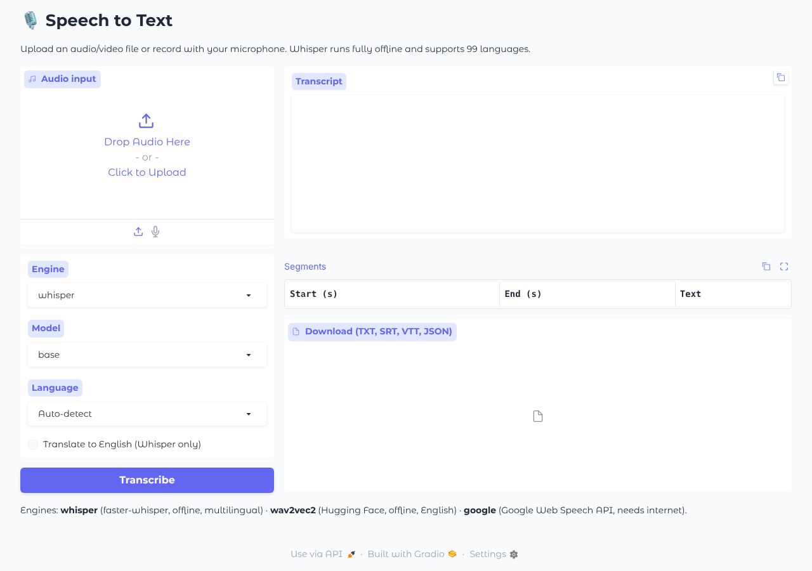

# 🎙️ SPEECH-TO-TEXT

**COMPANY:** CODETECH IT SOLUTIONS
**NAME:** DEEPAK K
**INTERN ID:** CT08GMD
**DOMAIN:** ARTIFICIAL INTELLIGENCE
**BATCH DURATION:** December 25th, 2024 to January 25th, 2025
**MENTOR NAME:** NEELA SANTHOSH

> **Task:** build a speech-to-text system using pre-trained models and libraries like SpeechRecognition or Wav2Vec.

This project goes beyond the basic task: it is a complete speech recognition app
with a web interface, a command line tool and **three interchangeable engines**,
including OpenAI's **Whisper**, the current state of the art in open speech recognition.



## Features

- **Three engines**, one interface
  | Engine | Library | Runs | Languages | Notes |
  |---|---|---|---|---|
  | `whisper` (default) | [faster-whisper](https://github.com/SYSTRAN/faster-whisper) | Offline, CPU or GPU | 99 | Best accuracy, timestamps, translation to English |
  | `wav2vec2` | [Hugging Face transformers](https://huggingface.co/facebook/wav2vec2-base-960h) | Offline | English | Classic CTC model from Facebook AI |
  | `google` | [SpeechRecognition](https://pypi.org/project/SpeechRecognition/) | Online | Many | No model download, needs internet |
- **Web UI** (Gradio): upload a file or record from the microphone, see segments with timestamps, copy or download the result
- **Any input format**: WAV, MP3, M4A, FLAC, OGG, WEBM and video files (via ffmpeg)
- **Export** as plain text, SRT or VTT subtitles, or JSON
- **Language auto-detection** and **speech translation** to English (Whisper)
- **Voice activity detection** skips silence for faster, cleaner output
- **CLI** for batch transcription and microphone recording
- Unit tests, GitHub Actions CI and a Dockerfile

## Project structure

```
├── app.py                   # Gradio web app
├── speech_to_text/
│   ├── engines.py           # Whisper, wav2vec2 and Google engines
│   ├── audio.py             # audio loading and chunking
│   ├── formats.py           # TXT / SRT / VTT / JSON export
│   └── cli.py               # command line interface
├── tests/                   # pytest suite (no model download needed)
├── requirements.txt
└── Dockerfile
```

## Setup

Requirements: **Python 3.10+** and **ffmpeg**.

```bash
# 1. Install ffmpeg
#    Windows: winget install ffmpeg    macOS: brew install ffmpeg    Ubuntu: sudo apt install ffmpeg

# 2. Clone and create a virtual environment
git clone https://github.com/Deepak-k21/SPEECH-TO-TEXT.git
cd SPEECH-TO-TEXT
python -m venv .venv
source .venv/bin/activate        # Windows: .venv\Scripts\activate

# 3. Install dependencies
pip install -r requirements.txt

# Optional extras
pip install torch transformers   # wav2vec2 engine
pip install sounddevice          # microphone recording from the CLI
```

The first run downloads the selected Whisper model from Hugging Face
(`base` is about 150 MB) and caches it for later runs.

## Usage

### Web app

```bash
python app.py                 # open http://127.0.0.1:7860
python app.py --share         # also create a temporary public link
```

### Command line

```bash
# Transcribe a file and print the text
python -m speech_to_text meeting.mp3

# Use a bigger model and save subtitles
python -m speech_to_text lecture.mp4 -m small -f srt -o outputs/

# Force a language, or translate Hindi/Tamil/... speech to English
python -m speech_to_text talk.wav -l ta
python -m speech_to_text talk.wav --translate

# Other engines
python -m speech_to_text clip.wav -e wav2vec2
python -m speech_to_text clip.wav -e google -l en-IN

# Record 10 seconds from your microphone
python -m speech_to_text --mic 10

# List available models
python -m speech_to_text --list-models
```

### From Python

```python
from speech_to_text import get_engine
from speech_to_text.formats import render

engine = get_engine("whisper", "base")
result = engine.transcribe("audio.wav")
print(result.text)
print(render(result, "srt"))
```

## Choosing a Whisper model

| Model | Size | Speed | Accuracy |
|---|---|---|---|
| `tiny` | 75 MB | fastest | basic |
| `base` (default) | 150 MB | very fast | good |
| `small` | 500 MB | fast | better |
| `medium` | 1.5 GB | moderate | very good |
| `large-v3-turbo` | 1.6 GB | fast on GPU | excellent |
| `large-v3` | 3 GB | slow on CPU | best |

`.en` variants (e.g. `base.en`) are slightly more accurate for English only audio.
A CUDA GPU is used automatically when available.

## Docker

```bash
docker build -t speech-to-text .
docker run -p 7860:7860 speech-to-text
```

## Tests

```bash
pip install -r requirements-dev.txt
pytest
```

The tests replace the models with fakes, so they run in seconds without downloads.

## How it works

1. **Audio loading**: ffmpeg/librosa decode the input and resample to 16 kHz mono, the rate all three models expect.
2. **Recognition**:
   - *Whisper* is an encoder-decoder Transformer trained on 680k hours of multilingual audio. faster-whisper runs it with CTranslate2 for up to 4x faster inference with lower memory, and a Silero VAD filter removes silence.
   - *wav2vec2* learns speech representations by self-supervision, then a CTC head fine-tuned on LibriSpeech maps audio frames to characters. Audio is processed in 20 second chunks.
   - *Google Web Speech* sends 45 second chunks to Google's free recognition endpoint.
3. **Output**: segments with start/end times are joined into text or written as subtitles.
